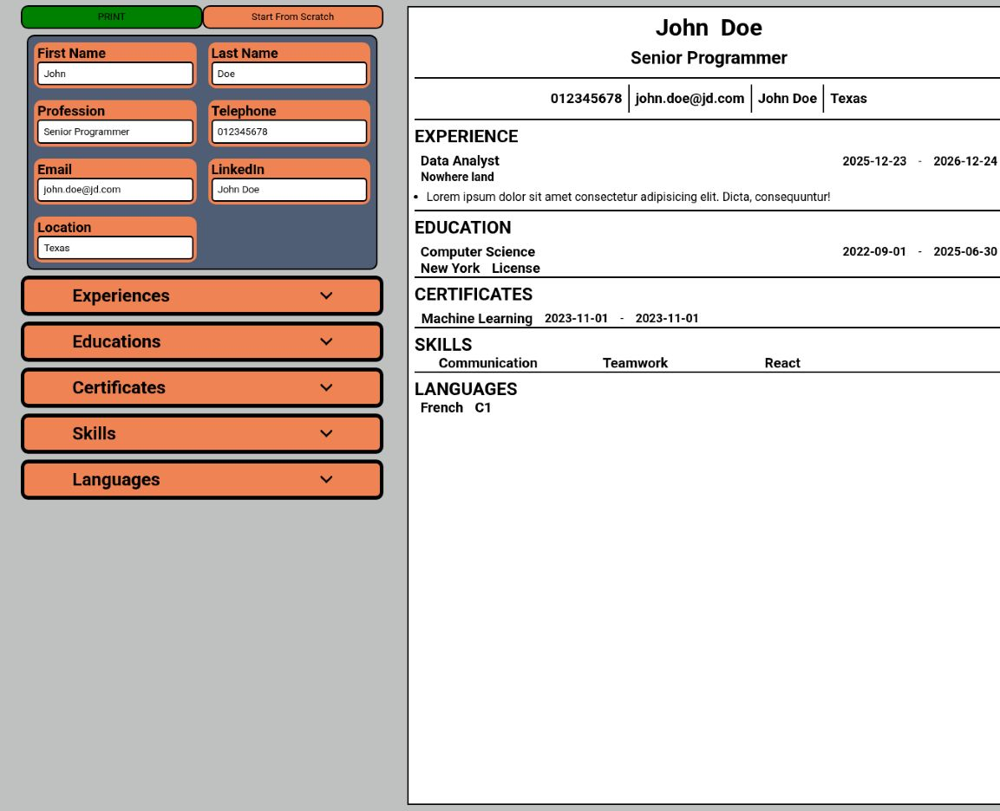
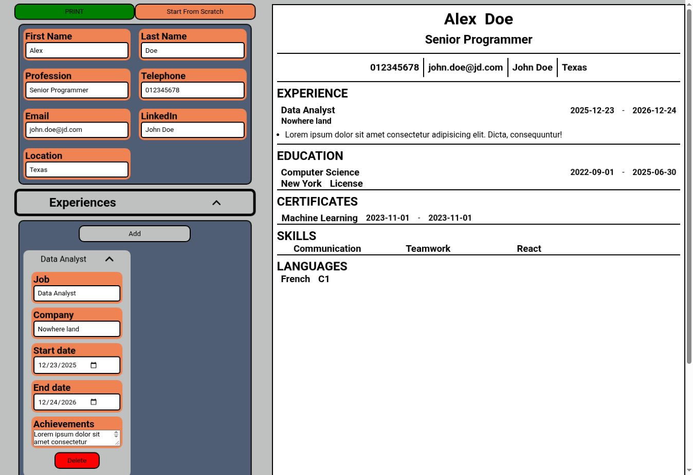

# CVBuilder

A React CV editor with an instant document preview. Edit personal details, experience, education, certificates, skills, and languages, then use the browser's print dialog to print the result or save it as a PDF.

**[Open the live demo](https://cv-designer-theta.vercel.app/)**



## Features

- Live preview: changes in the editor immediately update the document.
- Separate editors for contact information, experience, education, certificates, skills, and languages.
- Add and remove entries in repeatable sections.
- Collapsible sections and individual entry editors.
- Example content to explore the interface, plus a **Start From Scratch** action.
- Print styling that hides the editor and displays the CV.



The screenshots show the running demo with sample information. PDF saving uses the browser's print destination; the app does not include a separate PDF-generation service.

## How it works

`src/App.jsx` owns the CV data and passes it into two complementary views: the editing forms and the document preview. Form callbacks update that shared state, so the preview does not need a separate copy of the data.

Repeatable sections are stored as arrays. Add, edit, and delete handlers update those arrays, while smaller components render individual entries. Print-specific CSS controls which part of the interface appears on paper.

| Location | Responsibility |
| --- | --- |
| `src/App.jsx` | Initial data, shared React state, and update handlers |
| `components/edit.jsx` | Connects the section editors to the state handlers |
| `components/edit*.jsx` | Forms for the different CV sections |
| `components/page.jsx` | Assembles the CV preview |
| `components/header.jsx`, `experience.jsx`, `education.jsx` | Displays document content |
| `src/index.css` | Editor layout, document styling, and print rules |

## Tech stack

React, JavaScript, CSS, Vite, and ESLint. The application runs in the browser and does not require a backend or database.

## Run locally

Use Node.js 22.12+ and npm. The production build was checked with Node.js 24.

```bash
git clone https://github.com/Pourixa/CVBuilder.git
cd CVBuilder
npm ci
npm run dev
```

Open the local URL printed by Vite. No environment variables are required.

| Command | Purpose |
| --- | --- |
| `npm run dev` | Start the development server |
| `npm run build` | Build the application into `dist/` |
| `npm run preview` | Preview the production build locally |
| `npm run lint` | Run ESLint |

## Current scope

CV data is kept in memory: refreshing the page restores the example content. There is no account system, autosave, or cloud storage. The document uses a fixed page-sized layout with hidden overflow, so long CVs need further pagination work; the editor is best explored on a desktop-sized screen.

